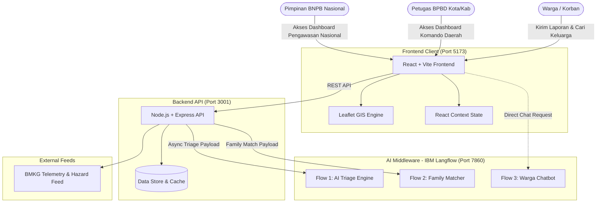

# SalingJaga 🛡️
> **Tanggap, Bantu, Lindungi** — Platform Komando Tanggap Bencana Terpadu, Pemetaan GIS Real-Time, AI Triage, Pencocokan Keluarga Cerdas, dan Verifikasi Anti-Hoaks Berbasis IBM Langflow.

[](https://vitejs.dev/)
[](https://react.dev/)
[](https://nodejs.org/)
[](https://www.langflow.org/)
[](https://opensource.org/licenses/MIT)

---

## 📌 Daftar Isi
- [Tentang SalingJaga](#-tentang-salingjaga)
- [Problem Statement & Solusi](#-problem-statement--solusi)
- [Fitur Utama](#-fitur-utama)
- [Integrasi IBM Langflow](#-integrasi-ibm-langflow)
- [Arsitektur Sistem](#-arsitektur-sistem)
- [Struktur Peran & Akses Pengguna](#-struktur-peran--akses-pengguna)
- [Panduan Instalasi & Menjalankan Proyek](#-panduan-instalasi--menjalankan-proyek)
- [Variabel Lingkungan (.env)](#-variabel-lingkungan-env)
- [Struktur Folder](#-struktur-folder)
- [Lisensi](#-lisensi)

---

## 📖 Tentang SalingJaga

**SalingJaga** adalah platform komando terintegrasi yang dirancang untuk memecahkan hambatan komunikasi, keterlambatan pemilahan korban, dan disinformasi selama masa tanggap darurat bencana (*Golden Hour*).

Dengan memanfaatkan orkestrator visual **IBM Langflow**, SalingJaga mentransformasi laporan teks tidak terstruktur dari warga dan media sosial menjadi data taktis siap tindak: mengotomatisasi penentuan skala prioritas (skor 0–100), menyarankan kebutuhan logistik darurat, memetakan pengerahan tim SAR/medis, serta mempertemukan kembali anggota keluarga yang hilang melalui *semantic matchmaking*.

---

## 🚨 Problem Statement & Solusi

| Kondisi Konvensional (Sebelum Solusi) | Pendekatan SalingJaga |
|---|---|
| **Penumpukan Laporan Manual**: Ratusan laporan menumpuk di WhatsApp/call center; operator membaca satu per satu sehingga laporan kritis terlambat ditangani. | **AI Disaster Triage**: Memproses dan mengekstrak entitas kritis (lokasi, korban rentan, kedalaman banjir) dalam hitungan **< 1,5 detik**. |
| **Pencarian Keluarga Terpisah Lambat**: Keluarga harus menghubungi posko satu per satu atau membolak-balik buku tamu kertas di pengungsian. | **AI Family Matchmaking**: Algoritma semantik mencocokkan ciri fisik, pakaian terakhir, dan usia korban hilang dengan registrasi pengungsi lintas posko. |
| **Data Koordinasi Tersegel (*Siloed*)**: BPBD Daerah dan BNPB Nasional memiliki versi data berbeda, memicu tumpang tindih distribusi bantuan. | **Unified Command Center**: Satu sumber kebenaran (*Single Source of Truth*) dengan Peta Situasi GIS yang sinkron secara *real-time*. |
| **Penyebaran Hoaks & Kepanikan**: Laporan palsu atau dilebih-lebihkan membuang sumber daya regu penyelamat ke lokasi kosong. | **Smart Quarantine & Witness Voting**: Laporan mencurigakan otomatis dikarantina, diverifikasi silang data BMKG, dan divalidasi saksi warga sekitar. |

---

## 🌟 Fitur Utama

### 1. 🛰️ Peta Situasi GIS Interaktif (*Live Disaster Map*)
- **Visualisasi Geospasial Multi-Layer**: Menampilkan sebaran titik bencana berkode warna urgensi (🔴 Kritis, 🟠 Tinggi, 🟡 Sedang, 🟢 Rendah) dengan animasi radar detak (*pulsing radar*).
- **Radius Bahaya & Fasilitas Kritis**: Menampilkan lingkaran perimeter dampak langsung, lokasi posko pengungsian primer beserta ketersediaan bed, fasilitas kesehatan siaga, dan depo logistik.
- **Pencarian & Filter Cepat**: Filter bencana instan, pencarian nama dusun/kelurahan, dan tombol *“Lokasi Saya”*.

### 2. ⚡ AI Disaster Triage (Ditenagai IBM Langflow)
- **Ekstraksi Otomatis**: Membaca laporan narasi bebas dan mengekstrak jumlah korban rentan (balita, lansia, luka berat), tingkat ketinggian air/kerusakan, dan kebutuhan alat evakuasi.
- **Skor Urgensi & SLA**: Menetapkan tingkat prioritas dan batas waktu respons operasional (SLA, misal `< 1 Jam`).
- **Rekomendasi Taktis BPBD**: Menyarankan jenis relawan spesifik (SAR Air, Paramedis Darurat) dan paket logistik yang wajib segera dikirim.
- **Autonomous Neural Fallback**: Mode *fallback* otomatis memastikan demo dan penanganan sistem tetap berjalan 100% mulus sekalipun koneksi eksternal terputus.

### 3. 🔍 AI Family Matchmaking (Reunifikasi Posko)
- **Pencarian Cerdas Tanpa Typo Bias**: Mencari orang hilang dengan membandingkan kemiripan semantik ciri fisik, rentang usia, warna pakaian terakhir, dan lokasi posko.
- **Skor Kecocokan (Confidence %)**: Memberikan estimasi tingkat probabilitas kecocokan untuk mempermudah petugas posko memverifikasi identitas keluarga.

### 4. 🛡️ Karantina Laporan & Verifikasi Anti-Hoaks
- **Ruang Karantina Laporan**: Laporan baru dengan anomali ditahan sementara sebelum disetujui tampil di peta publik.
- **Validasi Silang Cuaca BMKG**: Memverifikasi klaim bencana hidrometeorologi terhadap indeks curah hujan BMKG.
- **Witness Voting**: Saksi warga di sekitar koordinat kejadian dapat memberikan konfirmasi suara keabsahan laporan.

### 5. 🤝 Pusat Pengerahan Relawan & Logistik
- **1-Click Dispatch Modal**: Penugasan instan tim relawan (Tim SAR Air, Paramedis, Dapur Umum Tagana, Unit K9, Truk 4x4) dilengkapi instruksi taktis lapangan.
- **Transparansi Logistik**: Pelacakan kebutuhan vs pasokan terkumpul secara akuntabel (perahu karet, selimut, air mineral, susu balita).

### 6. 📡 Early Warning System (EWS) Telemetri
- **Sensor Telemetri Terhubung**: Sensor Muka Air DAS (Siaga 1-4), stasiun curah hujan, dan sensor gempa.
- **Broadcast Sirene Darurat**: Simulasi siaran darurat massal ke kontak warga di radius bahaya dengan Web Audio API native.

---

## 🤖 Integrasi IBM Langflow

SalingJaga memanfaatkan IBM Langflow sebagai *AI Orchestrator Engine* yang terhubung melalui REST API:

```
[ Laporan Warga / Data Orang Hilang ]
                 ↓
      [ Chat / Text Input Node ]
                 ↓
   [ Prompt Template Kebencanaan ]
  - Role: Emergency Disaster Triage Officer
  - Few-shot Rules & Emergency Priority Formula
  - Strict JSON Schema Enforcement
                 ↓
  [ LLM Inference Engine (Granite/Watsonx/OpenAI) ]
                 ↓
     [ Structured JSON Output ]
                 ↓
[ Backend & Frontend SalingJaga State ]
```

### Flow yang Digunakan:
1. **Flow 1: AI Disaster Triage (`LANGFLOW_TRIAGE_FLOW_ID`)**
   - **Input:** Teks narasi bebas laporan warga.
   - **Output:** JSON terstruktur (`prioritas`, `skor`, `ringkasan`, `kebutuhanUtama`, `jenisRelawan`, `tindakanAdmin`, `batasWaktuRespons`).
2. **Flow 2: AI Family Matchmaking (`LANGFLOW_FAMILY_MATCH_FLOW_ID`)**
   - **Input:** Profil identitas orang hilang dan kandidat data registrasi posko pengungsian.
   - **Output:** JSON rekomendasi kecocokan identitas dengan skor persentase keyakinan.
3. **Flow 3: Chatbot Bencana Warga (`LANGFLOW_CHATBOT_FLOW_ID`)**
   - **Input:** Pertanyaan interaktif warga terkait panduan evakuasi dan nomor darurat.
   - **Output:** Respons cepat dan panduan keselamatan terverifikasi.

---

## 🏗️ Arsitektur Sistem



---

## 🔐 Struktur Peran & Akses Pengguna

Platform dilengkapi dengan pembatasan hak akses (*Role-Based Gates*) dengan kredensial pre-filled untuk kemudahan demonstrasi:

| Peran | Rute Portal | ID Pengguna | Sandi | Cakupan Wewenang |
|---|---|---|---|---|
| **Masyarakat Umum** | `/` | *-* | *-* | Lapor bencana, cari keluarga hilang, pantau peta situasi, cek info posko. |
| **BPBD Daerah** | `/bpbd` | `12345678` | `bpbd` | Eksekusi AI Triase, kerahkan armada relawan, verifikasi laporan, kelola logistik lokal. |
| **BNPB Nasional** | `/bnpb` | `99999999` | `bnpb` | Pengawasan lintas daerah, alokasi bantuan cadangan nasional, analitik makro kebencanaan. |

---

## 🚀 Panduan Instalasi & Menjalankan Proyek

### Prasyarat
- **Node.js** versi 18 ke atas
- **npm** versi 9 ke atas
- *(Opsional untuk Live AI)* Instance **IBM Langflow** aktif (lokal atau cloud)

### 1. Clone Repository
```bash
git clone https://github.com/username/salingjaga.git
cd salingjaga
```

### 2. Menjalankan Backend API
```bash
cd backend
npm install
node server.js
```
*Backend berjalan di: `http://localhost:3001`*

### 3. Menjalankan Frontend Web
Buka terminal baru di direktori utama:
```bash
npm install
npm run dev
```
*Frontend berjalan di: `http://localhost:5173`*

---

## ⚙️ Variabel Lingkungan (.env)

### Frontend (`.env` di root folder):
```env
# URL server Langflow (default lokal)
VITE_LANGFLOW_URL=http://localhost:7860

# Flow ID Chatbot Warga
VITE_LANGFLOW_CHAT_FLOW_ID=2711834c-3cec-4a25-93df-524bc13593ee

# Flow ID Triase Bencana (Flow 1)
VITE_LANGFLOW_FLOW_ID=0c029d7b-4036-4a66-8aa4-a364cd3ee528
```

### Backend (`backend/.env`):
```env
PORT=3001

# Ganti ke 'langflow' untuk mengaktifkan pemrosesan live AI Langflow
AI_MODE=langflow

LANGFLOW_BASE_URL=http://localhost:7860
LANGFLOW_API_KEY=your_langflow_api_key_here

LANGFLOW_FAMILY_MATCH_FLOW_ID=f70b6854-1fed-475c-9f11-238d97242bc8
LANGFLOW_TRIAGE_FLOW_ID=0c029d7b-4036-4a66-8aa4-a364cd3ee528
LANGFLOW_CHATBOT_FLOW_ID=2711834c-3cec-4a25-93df-524bc13593ee
```

---

## 📁 Struktur Folder

```text
salingjaga/
├── backend/
│   ├── server.js              # Server REST API Express & Handler Langflow
│   ├── .env.example           # Contoh konfigurasi backend
│   └── package.json
├── src/
│   ├── components/            # Komponen UI (Peta, Modal Dispatch, Login, Shelter)
│   │   ├── national/          # Komponen Dasbor Komando BNPB Nasional
│   │   ├── AddModal.jsx       # Modal pelaporan bencana warga
│   │   ├── DetailModal.jsx    # Modal Triage & Analisis AI
│   │   ├── Map.jsx            # Peta GIS Leaflet interaktif
│   │   └── ...
│   ├── context/
│   │   └── AppContext.jsx     # State global & integrasi AI Fallback/Langflow
│   ├── data/
│   │   └── dummyData.js       # Skenario showcase data tanggap darurat
│   ├── pages/
│   │   ├── Dashboard.jsx      # Dasbor Komando BPBD Daerah
│   │   ├── PublicPortal.jsx   # Portal Layanan Warga
│   │   └── NationalBPBDAdminPage.jsx
│   ├── App.jsx                # Routing & Auth Gates
│   └── main.jsx
├── public/                    # Aset statis & ikon
├── langflow-prompt.txt        # Template Prompt System IBM Langflow
├── README.md                  # Dokumentasi Proyek
└── package.json
```

---

## 📄 Lisensi

Didistribusikan di bawah lisensi **MIT License**. Lihat file `LICENSE` untuk informasi selengkapnya.

---

<p align="center">
  <b>SalingJaga</b> — <i>Tanggap Cepat, Bantu Tepat, Lindungi Bersama.</i> 🌿
</p>
